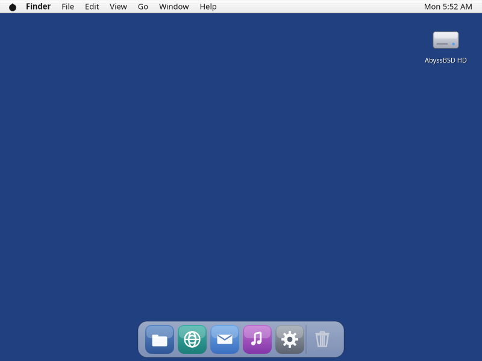

# AbyssBSD desktop (ADE)

The desktop of [AbyssBSD](../README.md), written in Rust, on Wayland, on
its own compositor. Mac OS X 10.2 "Jaguar" was one of its design guides: the
global menu bar, the Dock, the Finder and the default theme, Aqua, come from
there. It is not a clone. Themes are data, and the desktop looks however the
theme says.



## What's here

- **The shell.** Wallpaper and desktop icons, the global menu bar with its
  status items, and the magnifying Dock. Islands (workspaces), Shoals
  (window sets) and Ebb (an Exposé equivalent) replace tiling.
- **The applications.** Finder, System Preferences, Terminal, TextEdit,
  Grab, Activity Monitor, Disk Utility, System Profiler, the Setup Assistant
  and the installer.
- **The session.** The login window, the lock screen, idle and power, and
  `anchor`, which starts the session and restarts what dies.
- **The compositor.** `undertow`, built on wlroots.
- **The services.** Applications talk to each other and to the desktop over
  `CurrentIPC`, typed messages with file descriptors on Unix sockets. There
  is no message bus. The portal hands applications descriptors, not paths.
  GTK applications get a D-Bus *bridge* (`abyss-dbus`) that answers only for
  ADE's own services, so their menus reach the menu bar.
- **Confinement.** `abyss-jaild` puts applications and agents in jails;
  an agent reaches only what a person gave it.
- **Themes.** A theme is data under `themes/`, switched while the desktop
  runs: Aqua, the default, and Trench, which looks nothing like a Mac and
  proves the format can say more than one thing.

## Build and run

On Linux, with cairo, freetype, harfbuzz, fontconfig, pixman, xkbcommon,
wayland and wlroots 0.20 installed, and sway for the session and the live
tests:

```sh
cargo build --workspace --bins --examples
cargo test --workspace

# One scene, rendered to a PNG with no compositor:
AQUA_RENDER_PNG=/tmp/aqua.png AQUA_SCALE=2 target/debug/AquaDemo

# The desktop, in a nested sway window:
abyss/session.sh
```

`AquaDemo` draws every scene in the toolkit, offscreen or in a window;
`AQUA_SCENE` picks one. `abyss/session.sh --help` lists the session's
modes (nested, attached, headless).

## Testing

`abyss/tests/run.sh` is the loop. Each lane adds to the one before it:

| Command | Runs |
|---|---|
| `run.sh` | build, unit tests, a headless render |
| `run.sh --live` | every live script against headless sway and `undertow` |
| `run.sh --vm` | the same, inside the FreeBSD build VM |
| `run.sh --vm --live --full` | and the installs under nested bhyve, booted |

`abyss/tests/golden.sh` compares every scene against the reference images.
The target is FreeBSD, so a change counts as green only once it passes in
the VM too. [abyss/vm/README.md](abyss/vm/README.md) sets the VM up.
`--full` is the rule for anything touching the installer, the medium or the
boot path.

## Layout

| Path | What |
|------|------|
| `de/abyss-sys` | every `unsafe` in the tree, and the build of the C shims (`de/c*`) |
| `de/aquadraw` | drawing: draw lists, text, themes and the Jaguar tokens |
| `de/surface` | the Wayland client runtime |
| `de/aqua` | the toolkit and the applications |
| `de/undertow` | the compositor (`undertowbin` is the binary) |
| `de/currentipc` | the control plane |
| `de/*wire`, `de/menumodel` | the messages services speak on it |
| `de/*bin`, `de/*ctl` | the daemons and their command-line faces |
| `de/aquademo` | `AquaDemo`, every scene |
| `themes/` | Aqua and Trench |
| `abyss/session.sh` | the dev session launcher |
| `abyss/tests`, `abyss/vm` | the test lanes and the FreeBSD build VM |
| `abyss/etc` | rc.d, devd and PAM files the image installs |

Each crate's `Cargo.toml` describes it in one line.

## Rules

- `unsafe` lives only in `de/abyss-sys`. C appears only as shims over system
  libraries, compiled there.
- No message bus, and never `dbus-daemon`.
- One foreign toolkit: GTK.
- Windows stay where they are put. No tiling.

## Documents

- [PRODUCT.md](docs/PRODUCT.md): what kind of OS this is, and why.
- [PLAN.md](docs/PLAN.md): the decisions and the phased roadmap.
- [STATUS.md](docs/STATUS.md): where things stand; start here to resume.
- [BACKLOG.md](docs/BACKLOG.md): the working list.
- [HANDOFF.md](docs/HANDOFF.md): lessons learned and the traps.
- [RUST.md](docs/RUST.md): the port from Swift, finished in 2026-10.
