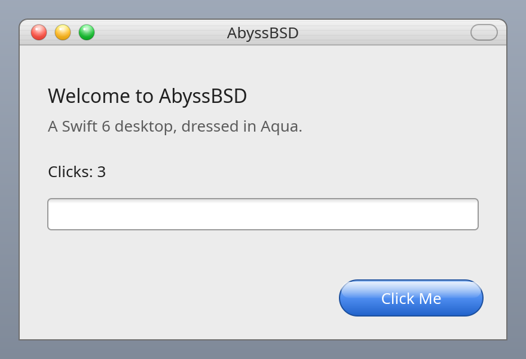

# AbyssBSD desktop (ADE)

AbyssBSD's desktop environment, written in **Rust**, styled as a faithful
**Mac OS X 10.2 "Jaguar" Aqua** clone, running on **Wayland** on its own
compositor (`undertow`).

> This is the monorepo's `desktop/`. It was written in Swift 6 through
> Phase 18 and ported to Rust in 2026-10 ([docs/RUST.md](docs/RUST.md));
> the Swift left the tree at R7. `unsafe` lives only in `de/abyss-sys`,
> which also compiles the small C shims (`de/c*`) over system libraries.



## Build & run (Linux dev box)

```sh
cargo build --workspace --bins --examples && cargo test --workspace

# Headless visual check (no compositor needed):
AQUA_RENDER_PNG=/tmp/aqua.png AQUA_SCALE=2 target/debug/AquaDemo

# Live, against a running wlroots compositor (install sway/labwc first):
target/debug/AquaDemo

# The whole desktop — a nested compositor plus the desktop, menu bar and Dock:
abyss/session.sh
```

Or the whole loop: `sh abyss/tests/run.sh`.


## Layout

| Path | What |
|------|------|
| `de/abyss-sys` | the FFI floor: every `unsafe`, and the C shims in `de/c*` |
| `de/aquadraw` | drawing: themes, draw lists, text, the Jaguar tokens |
| `de/surface` | the Wayland client runtime |
| `de/aqua` | the Jaguar toolkit and the applications (Finder, System Preferences, …) |
| `de/undertow` | the compositor |
| `de/aquademo` | `AquaDemo`, every scene, offscreen or in a window |
| `abyss/session.sh` | the dev session launcher — one command boots the desktop |
| `abyss/vm`, `abyss/tests` | FreeBSD build/test VM harness |
| `docs/` | [PLAN.md](docs/PLAN.md), [STATUS.md](docs/STATUS.md), [RUST.md](docs/RUST.md) |

See [docs/PLAN.md](docs/PLAN.md) for the full phased roadmap,
[docs/STATUS.md](docs/STATUS.md) to resume work, and
[docs/HANDOFF.md](docs/HANDOFF.md) for lessons learned + the traps to avoid.
